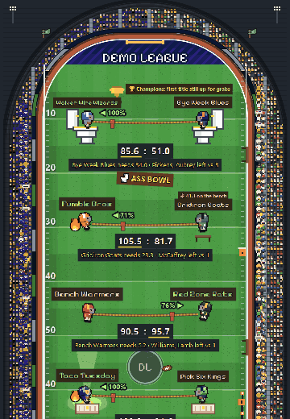

# Sleeper Stadium 🏈

Turn your [Sleeper](https://sleeper.com) fantasy football league into a live pixel stadium. Every team stands on the field
facing its opponent, scores update every minute on game day, and the whole league can watch from their phones.

**[▶ Try it with your league](https://savilar7-coder.github.io/sleeper-stadium/)** · free, no login, no ads ·
if you like it, a ⭐ helps a lot

[](https://savilar7-coder.github.io/sleeper-stadium/)

**What's on the field**
- 📺 **Live scores and projections** for every matchup, straight from Sleeper's public API
- 📊 **Score bars**: the outline is the projected total, the fill is live points
- 🔥 **Fire** on the top 2 scores, 🌧️ **rain** on the bottom 2
- 🏈 **Touchdown alerts**: a banner with the player who scored when a team jumps 4+ points
- 🔦 **Top scorer spotlight** on the week's highest scorer
- 🚽 **The ASS Bowl**: the two worst records sit on toilet thrones under their own sign; the top matchup stands on Greek podiums
- 🪑 **Bench of shame** for whoever left the most points on the bench
- 🦓 A **referee** who throws a yellow flag at negative scores
- 📺 A **jumbotron** (standings, biggest blowout, closest game), a **trophy case** of past champions,
  a **blimp** with your own banner, cheerleaders, a tailgate, and a stadium full of fans doing the wave
- 👑 **Rosters, picks, standings, league news** and a simple **trade maker** in the menus
- Pick your team and walk the field as a little football player
- 📰 A **news ticker** along the bottom, and a **🔗 Share** button that sends your league's own link to the group chat

## Use it

1. Find your Sleeper league ID: in the Sleeper app, **League → Settings → General → League ID** (or the long number in
   your league's web address).
2. Open the page and paste it, or link straight to `https://<your-site>/?league=<LEAGUE_ID>`.

That's it: no accounts, no keys, no server. Everything is read-only and comes from Sleeper's public API in the browser.

## Host your own copy (free)

It's a static site, so any static host works. With GitHub Pages:

1. Fork this repo.
2. **Settings → Pages → Deploy from a branch → `main` / root**.
3. Share `https://<you>.github.io/sleeper-stadium/?league=<LEAGUE_ID>` with your league.

To change the blimp's banner, edit `stadium-blimp.json`, or add `&blimp=Your%20text` to the link (60 characters).
Mascots can go in the link too: `&looks=<roster_id>.<Look>,...` (look names are in `js/stadium-main.js`, `ALL_LOOKS`).

## Run it locally

```bash
python -m http.server 8080
```

Then open `http://localhost:8080/?league=<LEAGUE_ID>`.

## Notes

- `sleeper-players.json` is a slimmed snapshot of Sleeper's NFL player list (name, position, team), so the page doesn't
  download Sleeper's 5 MB player file on every visit. Sleeper asks apps to fetch that list at most once a day.
- Not affiliated with Sleeper or the NFL. Team names and data belong to their owners.

## Credits

- Art: ["Ninja Adventure"](https://pixel-boy.itch.io/ninja-adventure-asset-pack) by Pixel-boy and AAA (CC0, public domain),
  plus pixel art drawn in code.
- Font: [Pixelify Sans](https://fonts.google.com/specimen/Pixelify+Sans) (SIL Open Font License), via Google Fonts.
- Game engine: [Phaser](https://phaser.io) (MIT).

Code: MIT (see `LICENSE`).

---

**Want it set up for your league in a minute?** Your own link, your trash talk on the blimp and a mascot for every
manager: [the $5 League Pass](https://lamaisonwebstudio.com/stadium/) (you make it and see it first, pay only if you like it).

**Podcast, Discord or business?** A stadium in your brand for your whole community (logo, colors, sponsors on the
jumbotron), or any other web tool or site: built by [lamaisonwebstudio.com](https://lamaisonwebstudio.com/stadium/#custom).
